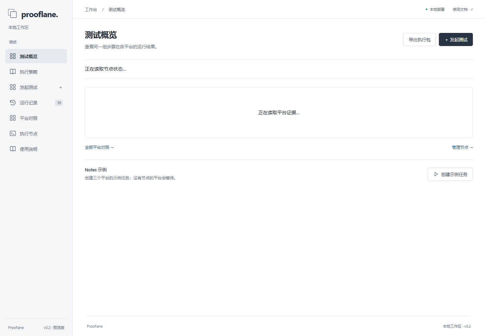

# Prooflane · 桌面应用跨平台验收

桌面应用验收工具。为 Windows、macOS、Linux 分别提供应用构建，用同一组步骤运行测试，再对照截图、录像和日志。

可以把执行包交给有设备的测试者，也可以连接长期在线的执行节点。项目目前处于预览阶段：**Windows 示例已有 GUI 执行记录；macOS、Linux 适配器已实现，尚待目标系统实测。**

[开始使用](docs/getting-started.md) · [交给测试者执行](docs/execution-strategy.md) · [文档目录](docs/README.md) · [参与开发](CONTRIBUTING.md)



上图是项目的实际页面。空白平台尚未执行；页面布局和协议测试通过，不代表对应系统的 GUI 测试通过。

## 快速开始

需要 Python 3.11+。在项目根目录打开 PowerShell：

```powershell
python -m venv .venv
.\.venv\Scripts\python.exe -m pip install -r requirements.txt
.\.venv\Scripts\python.exe -m uvicorn prooflane.app:app --host 127.0.0.1 --port 8765
```

打开 `http://127.0.0.1:8765/`。在 Windows 上，可以点击首页的“创建示例任务”，查看 Notes 示例的四步测试。Windows 示例需要本机 .NET Framework C# 编译器；没有编译器时可直接上传自己的应用。

运行 GUI 测试时保持桌面已登录、未锁屏。安装器会修改测试环境，请使用专用、可还原的测试机。

macOS / Linux 上的控制台安装、首次提交和常见启动问题见[开始使用](docs/getting-started.md)。

## 两种执行方式

| 方式 | 怎么使用 | 结果在哪里 |
| --- | --- | --- |
| 独立执行包 | 在“执行策略”选平台和具体任务，下载后发给测试者 | 测试者返回回执和证据 ZIP，由复核者核验；不会自动更新控制台 |
| 在线节点 | 在对应系统的桌面会话中启动节点，连接控制台 | 节点领取匹配任务，回传截图、录像和报告 |

通用说明包只包含说明和模板。绑定具体任务后才包含运行工具；应用文件可选择附带。设备由测试者提供或安排，项目本身不创建或租用测试机。

## 平台状态

| 目标系统 | 应用格式 | 当前证据 |
| --- | --- | --- |
| Windows | EXE、MSI、ZIP | 自带样本已完成桌面操作、安装、采集和报告验证；不代表所有 Windows 应用兼容 |
| macOS | 包含 APP 的 ZIP、DMG、PKG | 实验适配器；尚无 Mac GUI 运行记录 |
| Linux | AppImage、ZIP、tar.gz | 实验适配器；需要 X11、AT-SPI、D-Bus，尚无 Linux GUI 运行记录 |

Wayland、Android、iOS 暂不支持。控件操作依赖应用的可访问性接口；自绘界面、特殊权限和复杂安装流程需要单独验证。详见[节点接入](docs/multiplatform.md)和[验证记录](docs/validation.md)。

## 继续阅读

- [执行策略](docs/execution-strategy.md)：找测试者、准备输入、执行与回传。
- [证据验收](docs/handoff-acceptance.md)：核对构建、环境、步骤和复核结论。
- [配置说明](docs/configuration.md)：数据目录、环境变量、连接与备份。
- [API](docs/api.md)：上传构建、创建任务、查询与下载结果。
- [问题排查](docs/troubleshooting.md)：等待节点、权限、控件和采集问题。
- [架构](docs/architecture.md)：模块职责、任务流转和信任边界。

## 开发与维护

前端是原生 HTML / CSS / JavaScript，无需前端构建。后端使用 FastAPI、Pydantic 和 SQLite。

```powershell
.\.venv\Scripts\python.exe -m pip install -r requirements-dev.txt
.\.venv\Scripts\python.exe -m pytest -q
.\.venv\Scripts\python.exe scripts/check_docs.py
```

提交要求与 GUI 验证命令见[贡献指南](CONTRIBUTING.md)。[自动检查](.github/workflows/checks.yml)区分代码、文档检查和真实桌面验收；新增工作流需推送到 GitHub 后才能取得远端运行结果。

普通问题使用仓库 Issue；报告中附上最短复现步骤和环境。涉及凭据、越权或数据泄露的问题按[安全说明](SECURITY.md)处理。改动记录见 [CHANGELOG](CHANGELOG.md)。

## 使用边界与许可

当前面向可信操作员管理的本地测试环境，未提供公网账户认证、多租户隔离、虚拟机快照恢复或数据自动清理。节点凭据和运行目录不构成安全沙箱。

仓库尚未指定开源许可证。公开源码不等于授予开源使用、修改和再分发许可；对外发布前需由权利人确定许可证并加入 `LICENSE`。
