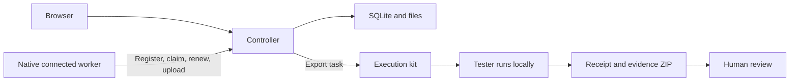

# Architecture

[简体中文](architecture.md) · **English**

FastAPI serves the API and static frontend. SQLite stores task metadata; the filesystem stores builds and evidence. There is no frontend build step or external task queue.

## Execution paths

The local worker shares the controller's machine. Remote workers initiate connections to the controller. Standalone execution uses an exported scenario and runtime modules without contacting the controller. Its evidence is not imported automatically; review conclusions are recorded separately.

## Modules

| Module | Responsibility |
| --- | --- |
| [app.py](../prooflane/app.py) | HTTP endpoints, uploads, access checks and service lifecycle |
| [models.py](../prooflane/models.py) | Task, step, comparison and review input constraints |
| [storage.py](../prooflane/storage.py) | SQLite, run directories, recovery and state persistence |
| [coordination.py](../prooflane/coordination.py) | Worker authentication, transactional claims, leases and result validation |
| [agent.py](../prooflane/agent.py) | Connected worker registration, download, execution, renewal and upload |
| [runner.py](../prooflane/runner.py) / [execute.py](../prooflane/execute.py) | Dispatch, process management, reports and Windows execution |
| [native.py](../prooflane/native.py) | macOS / Linux package preparation and native execution |
| [desktop_macos.py](../prooflane/desktop_macos.py) / [desktop_linux.py](../prooflane/desktop_linux.py) | Platform control interaction, window capture and environment checks |
| [strategies.py](../prooflane/strategies.py) / [handoff.py](../prooflane/handoff.py) | Kit exports and standalone local execution |
| [static/](../static/) | Pages, routing, polling, screenshots and recording controls |

## Runs and comparisons

A run binds one build, platform, architecture requirement and 3–5 steps. A campaign compares 2–3 targets. Step titles and actions must match across targets, while locators and expected values may differ.

Tasks begin queued or waiting for a worker, then move through preparation, installation and execution. Terminal states include `passed`, `review`, `failed`, `cancelled` and `interrupted`. See [storage.py](../prooflane/storage.py) for the definitions.

Workers claim matching platforms and architectures, with one task at a time per worker. Claims use SQLite transactions to prevent competing workers from receiving the same task. Leases currently last 45 seconds and are renewed during download, execution and upload. Expired leases interrupt the run and reject late results; the controller does not automatically reinstall the application.

## Required invariants

- Missing workers leave tasks waiting. Results from another system cannot stand in for execution.
- The controller preserves the build hash, original scenario and platform ownership; uploaded results cannot rewrite task provenance.
- Step states and media must belong to the same run. Frontend polling should not restart a recording the user is watching.
- Execution success and human review are separate. Missing evidence or screenshot review cannot silently become a pass.
- Kit exports use an explicit file allowlist. Data directories, credentials, local investigations and unrelated task evidence must stay out.
- Documentation languages share the original scenario and build hash. Translations must not change locators or expected results.

## Trust boundaries

Uploaded applications are executable code. Workers must be managed by trusted operators. Authentication controls task claims and uploads, but neither sandboxes third-party applications nor proves submitted screenshots are authentic.

Host / Origin checks and the client header limit cross-site calls; they do not authenticate public users. See the [Security policy](../SECURITY.en.md) for deployment boundaries.

## Validation

Unit and API tests cover input, archives, claims, leases and results. Browser checks cover interaction. Native desktop tests cover controls, window capture, installation and process lifecycle. Record these types of evidence separately. See [Contributing](../CONTRIBUTING.en.md) and [Validation records](validation.en.md).

Back to [Documentation](README.en.md).
