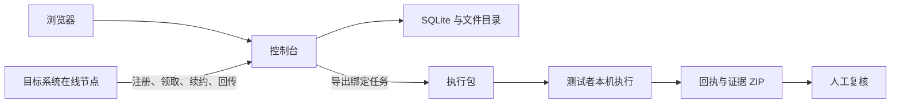

# 架构

Prooflane 使用 FastAPI 提供 API 和静态前端，SQLite 保存任务元数据，文件系统保存构建和证据。没有前端打包步骤，也不依赖外部任务队列。

## 两条执行路径

本机执行器与控制台运行在同一台机器；远程节点主动连接控制台。独立执行器使用导出的任务和运行模块，不连接控制台。其证据没有自动导入路径，复核结论另行登记。

## 模块职责

| 模块 | 职责 |
| --- | --- |
| [app.py](../prooflane/app.py) | HTTP 接口、上传、访问约束、服务生命周期 |
| [models.py](../prooflane/models.py) | 任务、步骤、平台对照和复核输入约束 |
| [storage.py](../prooflane/storage.py) | SQLite、任务目录、恢复与状态持久化 |
| [coordination.py](../prooflane/coordination.py) | 节点认证、事务领取、租约与回传校验 |
| [agent.py](../prooflane/agent.py) | 在线节点注册、下载、执行、续约和上传 |
| [runner.py](../prooflane/runner.py) / [execute.py](../prooflane/execute.py) | 执行调度、进程管理、报告及 Windows 桌面操作 |
| [native.py](../prooflane/native.py) | macOS / Linux 包准备及原生任务执行 |
| [desktop_macos.py](../prooflane/desktop_macos.py) / [desktop_linux.py](../prooflane/desktop_linux.py) | 各系统的控件操作、窗口采集和环境检查 |
| [strategies.py](../prooflane/strategies.py) / [handoff.py](../prooflane/handoff.py) | 执行包导出与脱离控制台的本机运行 |
| [static/](../static/) | 页面、路由、轮询、截图和录像交互 |

## 任务与平台对照

一次运行绑定一个构建、一个平台、一个架构要求和 3–5 个步骤。平台对照包含 2–3 个运行目标；各目标步骤名称和动作必须一致，控件定位和预期值可以不同。

任务先进入队列或等待节点，领取后进入准备、安装和运行阶段。最终状态包括 `passed`、`review`、`failed`、`cancelled`、`interrupted`。状态定义以 [storage.py](../prooflane/storage.py) 为准。

节点按平台和架构领取任务，每节点串行。领取在 SQLite 事务中完成，避免多个节点取得同一个任务。租约当前为 45 秒；下载、执行和回传期间持续续约。租约过期后标记中断，拒绝过期结果，不自动重新安装应用。

## 必须保留的约束

- 缺少目标节点时保留等待状态，不能从其他系统推断结果。
- 构建哈希、原始场景和平台归属由控制台保存，回传不能改写任务来源。
- 已执行步骤的状态和媒体必须对应同一次运行。前端轮询不应重置用户正在播放的录像。
- 执行成功与人工复核分开；缺失证据、人工截图检查不能静默算作通过。
- 导出使用文件白名单，不能把数据目录、凭据、本机调查或其他任务的证据放进执行包。

## 信任边界

上传应用属于可执行代码，执行节点应由可信操作员管理。节点认证约束谁能领取和回传，但不会把第三方应用隔离在沙箱中，也不证明第三方提交的截图真实可信。

控制台的 Host / Origin 检查与客户端请求头用于限制跨站调用，不构成公网用户认证。完整部署边界见[安全说明](../SECURITY.md)。

## 如何验证

单元和 API 测试覆盖输入、包边界、领取、租约及回传。浏览器测试覆盖页面交互；原生桌面测试验证控件、窗口采集、安装和进程生命周期。这三类证据分别记录，不能相互替代。入口见[贡献指南](../CONTRIBUTING.md)和[验证记录](validation.md)。

返回[文档目录](README.md)。
